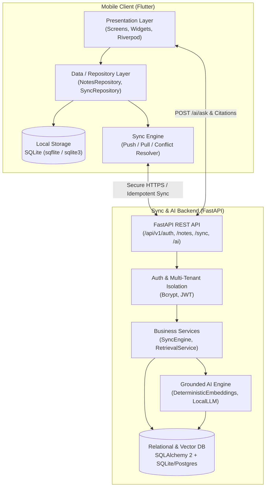

# PocketBrain Architecture

## 1. System Overview

PocketBrain is an offline-first personal knowledge repository and memory assistant. The architecture prioritizes client autonomy: users can capture, organize, search, and update their notes with zero network latency, while the backend provides durable multi-device synchronization and, in later phases, AI-grounded semantic retrieval.

---

## 2. Layer Responsibilities

### Mobile (Flutter)
- **Presentation Layer**: Screens (`HomeScreen`, `NoteEditorScreen`, `AiMemoryScreen`), reusable UI widgets, and Riverpod StateNotifiers/Providers (`notes_provider`, `sync_provider`, `ai_provider`). The UI never touches raw SQL or HTTP sockets directly.
- **Domain Layer**: Core immutable entities (`Note`, `Tag`, `Project`, `SyncOperation`), validation logic, and business rules.
- **Data Layer**:
  - `LocalDatabase`: SQLite database handling transactions, indexes, and fast local search.
  - `SyncQueue`: Tracks pending mutation operations (`CREATE`, `UPDATE`, `DELETE`) with stable client IDs (UUIDv4) and timestamps.
  - `ApiClient`: Dio-based REST client with interceptors for authentication tokens and network retries.
  - `AiRemoteDataSource`: Grounded memory query client with citation deserialization.

### Backend (FastAPI)
- **API Routers**: Versioned endpoints under `/api/v1/` validating request/response schemas (`/auth`, `/notes`, `/sync`, `/ai`).
- **Pydantic Schemas**: Strict type validation, serialization, and input sanitation.
- **Sync Service**: Idempotent mutation processing via `applied_operations` and watermark pull with soft-deletion propagation.
- **Grounded AI Retrieval Engine**:
  - `DeterministicEmbeddingProvider`: High-efficiency 256-dimensional subword and unigram vectorizer with stopword filtering.
  - `RetrievalService`: Multi-tenant scoped semantic search and automatic stale-embedding synchronization using SHA-256 content hashes.
  - `GroundedLocalLLMProvider`: Source-grounded answer synthesizer with anti-hallucination thresholding and verifiable verbatim excerpt citations.
- **Persistence Layer**: SQLAlchemy 2 models with Alembic schema migrations and tenant-isolated queries (`user_id == current_user.id`).

---

## 3. Communication & Data Flow

1. **Local Writes**: Note creation or edits write immediately to local SQLite and enqueue an operation in `SyncQueue`. The UI updates synchronously with zero network latency.
2. **Idempotent Push**: Pending mutations are pushed in batches with client-assigned operation UUIDs (`op_id`). The server logs executed operations in `applied_operations` to guarantee idempotency on retry.
3. **Conflict Preservation**: If the server's record version exceeds the client's baseline (`server_version > client_version`), overwrite is rejected (`status="CONFLICT"`). The mobile client branches the local edit into a sibling note (`"[Conflict] $title (Local Edit)"`) and accepts the authoritative server note. Zero human thoughts are lost.
4. **Incremental Pull**: Remote changes since `since_version` watermark are fetched. Soft-deletions (`is_deleted=true`) increment version and propagate down to clean up local storage, eliminating zombie notes.
5. **Grounded AI Retrieval**: The client queries `/api/v1/ai/ask`. Notes are filtered strictly by tenant ID, scored via cosine similarity, and synthesized into an answer with verbatim quotes. If evidence is below threshold, an explicit insufficient information notice is returned.

